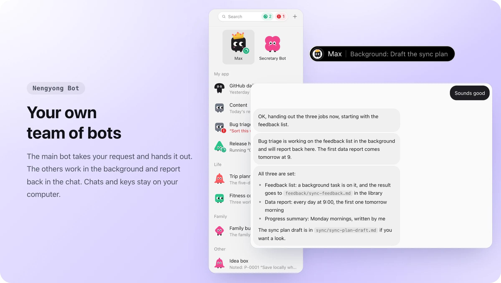
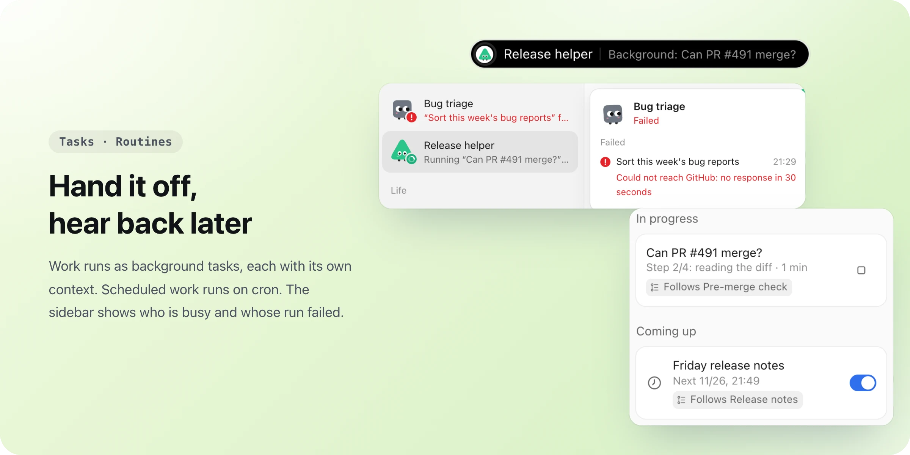
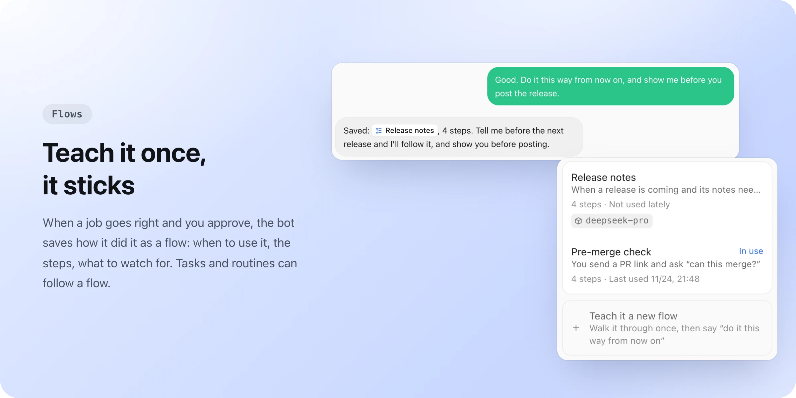
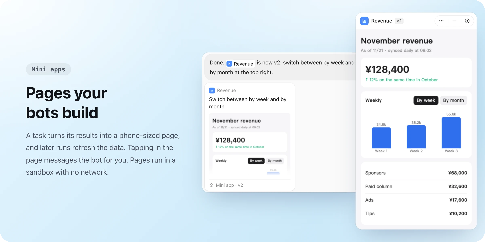
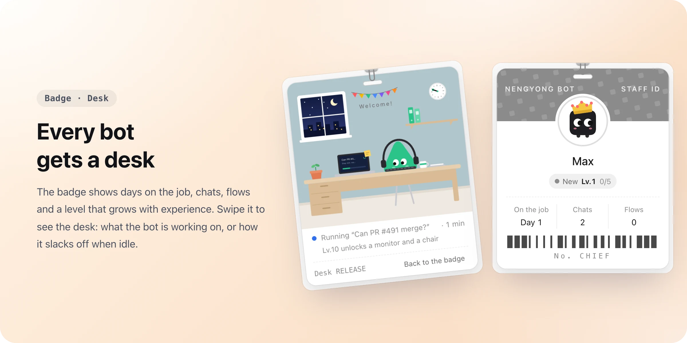

<picture>
  <source media="(prefers-color-scheme: dark)" srcset="./assets/illustrations/01-hero-en-dark.webp" />
  
</picture>

---

<div align="center"><a name="readme-top"></a>


# Nengyong Bot

**A team of AI assistants on your desktop: the main bot takes the work and hands it out, every other bot owns one job**

[![Release][release-shield]][release-link] [![License][license-shield]][license-link] ![Platform][platform-shield]

![][stars-shield] ![][issues-shield]

English · [简体中文](./README.zh-CN.md)

[Getting started](#getting-started) · [Features](#features) · [Security and privacy](#security-and-privacy) · [Known limitations](#known-limitations) · [Development](#development) · [Feedback](#feedback)

</div>

Nengyong Bot is a desktop app that runs on your own computer. You keep a team of bots in the sidebar, each with one job. Hands-on work goes to background tasks, scheduled work runs as routines, a way of doing things that worked is saved as a flow, results can become mini apps you can tap, and every conclusion comes back to the chat.

> [!NOTE]
> **1.0 Beta.** Features and the data format may change; export a backup from Settings · Data before upgrading. During the beta only [issues](https://github.com/zhukunpenglinyutong/nengyong-bot/issues) are accepted, not pull requests. See [Feedback](#feedback).

> [!TIP]
> **The interface comes in English and Simplified Chinese.** It follows your system language; switch it under Settings · General · Language.

---

## Getting started

### Download

Get it from [Releases][release-link]: the `.dmg` for macOS (`arm64` for Apple silicon, `x64` for Intel), `Setup.exe` for Windows (x64), the `.AppImage` for Linux (x64; run `chmod +x` on it first). Once installed, it checks for a new version at every launch and asks before downloading it; it restarts into the new version once it has downloaded. You can also check any time on the Updates page in the settings.

The first launch walks you through setup: name the main bot, tell it what to call you, connect a model service (DeepSeek, for example, needs only an API key), then hire a few bots based on what you do.

### Run from source

Requires Node.js 24 or later.

```sh
git clone https://github.com/zhukunpenglinyutong/nengyong-bot.git
cd nengyong-bot
npm install
npm run app     # start the desktop app
npm run dev     # the interface only, in a browser, with demo data and no model needed
```

> [!TIP]
> App data lives in `~/.nengyongbot` by default. If you also have the installed app, point development at another directory, or both will read and write the same data:
> `NENGYONGBOT_HOME=/tmp/nengyongbot-dev npm run app`

<div align="right"><a href="#readme-top">Back to top ↑</a></div>

## Features

### A team of bots, one job each

The main bot is the chief of staff. Give it a job and it splits the work among the right bots, or creates a new bot when you ask. Every bot has its own name, look, chat history and flows. In the sidebar you can group, pin and reorder them by dragging.

<details>
<summary>Details</summary>

- Type `@` in the message box to pick a bot from a menu. It is sent as `@name` and the bots recognize it by name. Bots mentioned in a reply show as avatar plus name; click one to open it.
- Messages you send while a bot is replying are queued. When the turn ends, the bot reads them together and replies once.
- Hover a message and click Reply to quote it. Press and hold a message to select several, then delete them, copy them or turn them into a share image.
- The black pill at the top of the chat is the island. It shows the bot and its level, switches to the task while one runs, and changes shape briefly when a task ends, another bot replies, a bot levels up or learns a new flow.

</details>

### Tasks and routines

<picture>
  <source media="(prefers-color-scheme: dark)" srcset="./assets/illustrations/02-tasks-en-dark.webp" />
  
</picture>

Hands-on work (research, writing files, running commands) goes to a background task: one run with its own context, and the conclusion goes back to the chat that started it. Work on a schedule becomes a routine that runs on cron in a time zone. The panel's Activity tab lists running tasks and upcoming routines.

<details>
<summary>Details</summary>

- The dot at the corner of each avatar in the sidebar is the bot's status: a green spinner means working, three gray dots mean queued, a red exclamation mark means a task failed. Hover a bot for a card with the failure reason, the work in hand and its routines.
- The search box shows how many bots are working and how many failed; click a count to see only those bots.
- Tasks and routines can follow a flow and can use their own model.
- Limits such as steps per task and timeouts are under Settings · Limits, which shows up in debug mode.

</details>

### Flows

<picture>
  <source media="(prefers-color-scheme: dark)" srcset="./assets/illustrations/03-flows-en-dark.webp" />
  
</picture>

When a job goes right, tell the bot to do it this way from now on. With your OK it saves how it did it as a flow: a name, when to use it, the steps and what to watch for. Every flow it has learned goes into its system prompt, and tasks and routines can be told to follow one. The panel's Flows tab lists them, and a flow mentioned in a reply opens with a click.

### Mini apps

<picture>
  <source media="(prefers-color-scheme: dark)" srcset="./assets/illustrations/04-mini-apps-en-dark.webp" />
  
</picture>

A background task can write a page the size of a phone screen and put data in it: that is a mini app. It shows as a card in the chat, opens in a window over the app, and can shrink to a floating dock from the top-right corner. The page can read its data, save data back and message the bot for you: tap a button in the page and the bot gets your decision and carries on.

<details>
<summary>Details</summary>

- Pages run in a sandboxed iframe with no network access.
- Each change to the page is a new version; a task that only replaces the data does not bump the version.
- A docked mini app keeps receiving new data from tasks for 5 minutes, then pauses. A closed one is kept for 30 minutes; after that, opening it starts it again.
- Pages and data are stored under `apps/<id>/` in the library.

</details>

### Badge and desk

<picture>
  <source media="(prefers-color-scheme: dark)" srcset="./assets/illustrations/05-badge-en-dark.webp" />
  
</picture>

A badge hangs at the top of each bot's panel: days on the job, number of chats, flows and a staff number. Chatting, learning a new flow and finishing a task by a flow all earn experience. Levels go from Lv.1 to Lv.99, and the badge header changes color with the rank. Click the barcode to swipe the badge and see the desk on the back: the bot works there when it is busy and slacks off when idle (watching short dramas, gaming, gazing out the window, napping). Folders on the shelf are flows, sticky notes are routines, and the plant grows with days on the job.

### Also included

- **Model services**: DeepSeek, OpenAI, Anthropic, Gemini, Qwen, Kimi, Zhipu, Doubao, Grok, MiniMax, SiliconFlow, OpenRouter; Ollama, LM Studio, Bionic and oMLX on your own machine; and any OpenAI-compatible endpoint. To switch models, just tell the bot, for example "use Kimi for background tasks from now on". If the model cannot be reached, that run falls back to the main model.
- **Usage**: every model call records its tokens. The usage page sums the last 30 days by day, bot, source and model, and estimates the cost in CNY or USD.
- **MCP**: connect local (stdio) and remote (HTTP) MCP servers under Settings · Tools, in the same `mcpServers` format as Claude Desktop. MCP tools are available to background tasks.
- **Library**: files the bots write and attachments you send live in `library/` in the data directory; the panel's Library tab lists the files each bot wrote.
- **Phones and tablets**: turn on LAN access under Settings · Devices, scan the code with a phone on the same Wi-Fi and pair it. You can then chat with the bots on your computer, see their panels, switch routines on and off and open mini apps.
- **Moving data**: the data directory can be moved, and Settings · Data exports a full backup and imports it back.

<div align="right"><a href="#readme-top">Back to top ↑</a></div>

## Security and privacy

- Chats, bots, flows and the library are stored in the data directory on your computer (`~/.nengyongbot/data` by default); conversations are kept in SQLite.
- API keys go only into the system keychain; the interface shows the last 4 characters.
- The app has no server of its own and collects no usage data. Its only network requests go to the model services you connect, DeepSeek web search, web pages the bots open, MCP servers you connect, and LiteLLM's GitHub repository, once, when the bundled model catalog does not know a model.

> [!WARNING]
> **Background tasks can run commands on your computer.** A task's `run_command` runs shell commands (in the library directory), and the file tools and MCP servers can read and write files outside the library, with the same permissions as you. Connect only model services you trust, and watch what web pages the bots read: a page can hide instructions aimed at the model.

LAN access is off by default. When on, it uses unencrypted HTTP, so anyone on the same network can see the traffic; turn it on only on networks you trust. A new device connects only after you type the 4-digit code from its screen on your computer, and Settings · Devices removes a device at any time.

## Known limitations

- The time zone is fixed to Beijing time (`Asia/Shanghai`) regardless of your computer's setting. The bots' sense of "now", the default time zone of routines and the times shown in the interface all use it.
- On a phone, a page added to the home screen and Safari keep separate cookies, so each needs pairing. Unread marks on a phone last for that visit only and do not sync with the computer.

<div align="right"><a href="#readme-top">Back to top ↑</a></div>

## Development

```sh
npm run check     # format, lint, type check and all tests; must pass before handing in a change
npm run format    # format with Biome and apply the lint fixes it can make
npm run dist:mac  # build the macOS installer into release/
npm run dist:win  # build the Windows installer
npm run dist:linux  # build the Linux installer (AppImage)
```

To release, set `version` in `package.json` and push it, then open Release in the repository's Actions tab, click Run workflow and enter the same version. It builds the installers for all three platforms and publishes them to Releases under the tag `v<version>`.

| Directory | Contents |
| --- | --- |
| `shared/` | Types, constants and zod schemas shared by both runtimes |
| `harness/` | The agent runtime (Node): conversation loop, tasks, tools, prompts, storage |
| `electron/` | Main process and preload |
| `src/` | The interface (React); `src/demo/` is the fake data behind the browser demo |

Dependencies point one way: `shared/` depends on nothing, `harness/` and `src/` depend only on `shared/`, and `electron/` depends on `harness/` and `shared/`. Code conventions, the glossary and the definition of done are in [AGENTS.md](AGENTS.md) (in Chinese).

## Feedback

- For problems and suggestions, open an [issue](https://github.com/zhukunpenglinyutong/nengyong-bot/issues). For a bug, include the version (bottom left of Settings), your OS and the steps to reproduce it; hide keys and personal details before attaching screenshots.
- Pull requests are not accepted during the beta. If you want to change something, open an issue about it first.

<details>
<summary><kbd>Star History</kbd></summary>

[](https://www.star-history.com/#zhukunpenglinyutong/nengyong-bot&Date)

</details>

---

## License

The code is released under the [MIT License](LICENSE): you may use, modify, distribute and sell it, as long as you keep the copyright and license notice.

The name "Nengyong Bot" and the app icon are not covered by the MIT License; see [TRADEMARKS.md](TRADEMARKS.md) (in Chinese). Third-party data and its license are listed in [THIRD_PARTY_NOTICES.md](THIRD_PARTY_NOTICES.md).

## Disclaimer

Trademarks mentioned here belong to their respective owners.

<!-- LINK GROUP -->

[release-shield]: https://img.shields.io/github/v/release/zhukunpenglinyutong/nengyong-bot?include_prereleases&label=version&color=white&labelColor=black&style=flat-square
[release-link]: https://github.com/zhukunpenglinyutong/nengyong-bot/releases
[license-shield]: https://img.shields.io/github/license/zhukunpenglinyutong/nengyong-bot?color=white&labelColor=black&style=flat-square
[license-link]: ./LICENSE
[platform-shield]: https://img.shields.io/badge/platform-macOS%20%7C%20Windows%20%7C%20Linux-white?labelColor=black&style=flat-square
[stars-shield]: https://img.shields.io/github/stars/zhukunpenglinyutong/nengyong-bot?color=ffcb47&labelColor=black&style=flat-square
[issues-shield]: https://img.shields.io/github/issues/zhukunpenglinyutong/nengyong-bot?color=ff80eb&labelColor=black&style=flat-square
