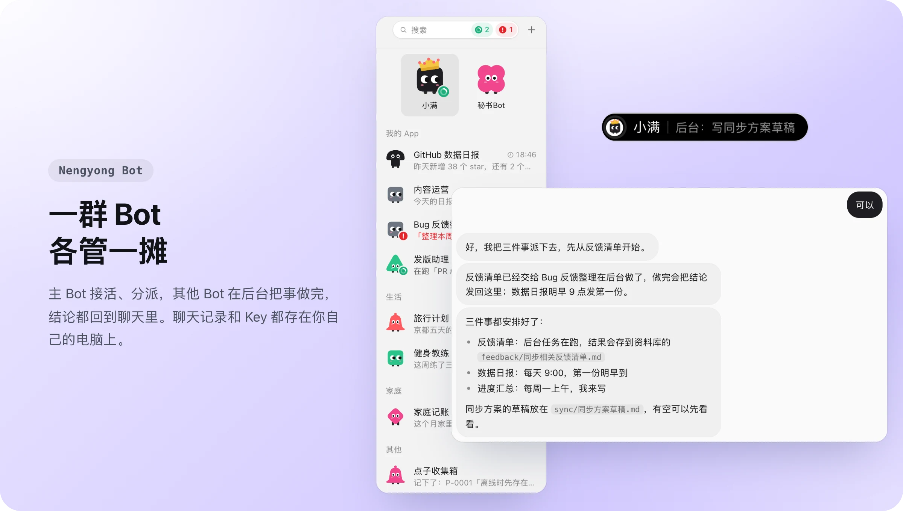
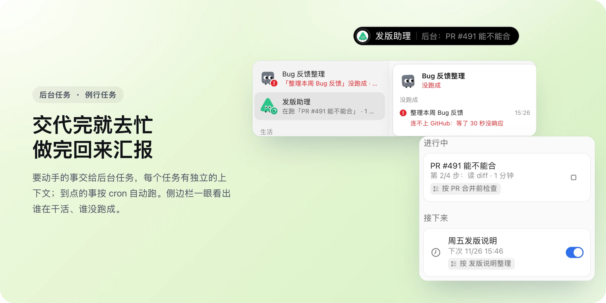
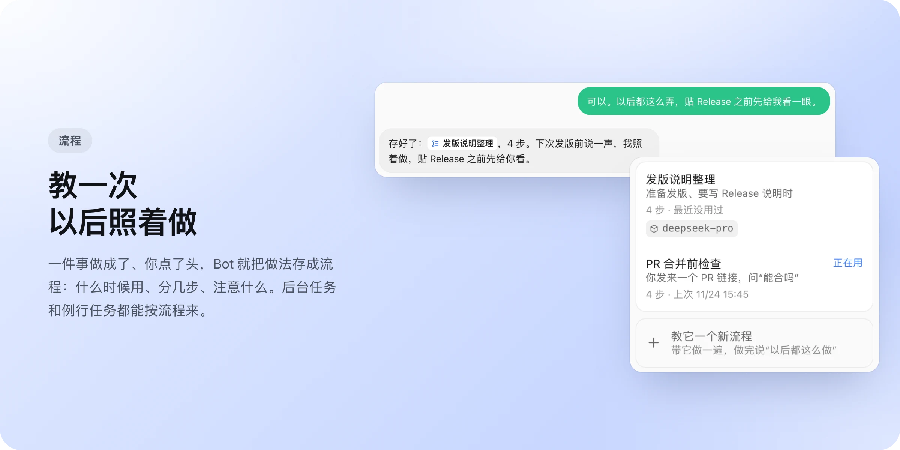
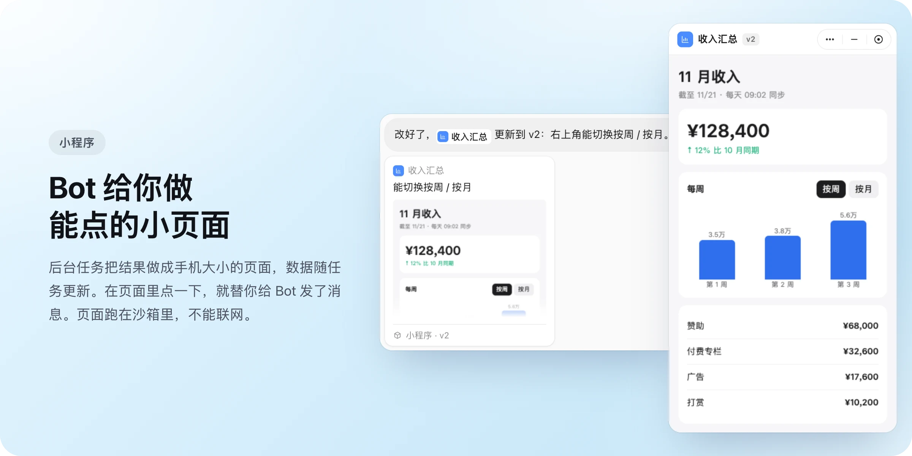
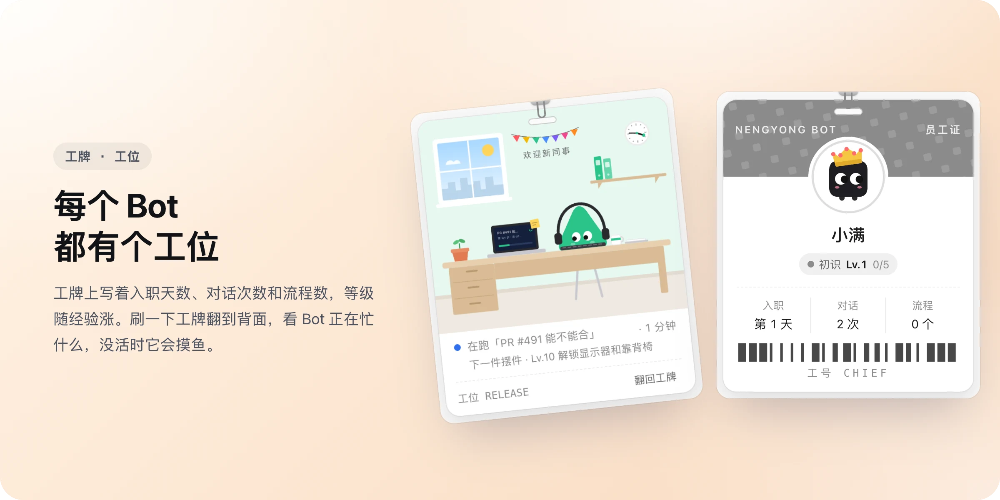

<picture>
  <source media="(prefers-color-scheme: dark)" srcset="./assets/illustrations/01-hero-zh-dark.webp" />
  
</picture>

---

<div align="center"><a name="readme-top"></a>


# Nengyong Bot（能用 Bot）

**一群在你电脑上干活的 AI 助手：主 Bot 接活分派，其他 Bot 各管一摊**

[![Release][release-shield]][release-link] [![License][license-shield]][license-link] ![Platform][platform-shield]

![][stars-shield] ![][issues-shield]

[English](./README.md) · 简体中文

[快速开始](#快速开始) · [功能](#功能) · [安全与隐私](#安全与隐私) · [已知限制](#已知限制) · [开发](#开发) · [反馈](#反馈)

</div>

Nengyong Bot 是一个在本机运行的桌面应用。你在侧边栏里养一群 Bot，每个管一件事：要动手的活交给后台任务，到点的事按例行任务自动跑，做成过的做法存成流程，结果可以做成能点的小程序，结论都回到聊天里。

> [!NOTE]
> **1.0 Beta。** 功能和数据格式都可能变，升级前建议先在「设置 · 数据」导出一份备份。Beta 期间只收 [Issue](https://github.com/zhukunpenglinyutong/nengyong-bot/issues)，暂不接受 Pull Request，见[反馈](#反馈)。

---

## 快速开始

### 下载安装

从 [Releases][release-link] 下载：macOS 用 `.dmg`（Apple 芯片选 `arm64`，Intel 选 `x64`），Windows（x64）用 `Setup.exe`，Linux（x64）用 `.AppImage`（下载后先 `chmod +x` 再运行）。装好以后，每次启动都会检查有没有新版本，有就弹窗问你，点「立即更新」才下载，下完自动重启；设置里的「更新记录」页也能随时检查。

第一次启动会进入引导：给主 Bot 起名、告诉它怎么称呼你、接一个模型服务（比如 DeepSeek，填 API Key 即可），再按你的身份招几个 Bot。

### 从源码运行

需要 Node.js 24 或更高版本。

```sh
git clone https://github.com/zhukunpenglinyutong/nengyong-bot.git
cd nengyong-bot
npm install
npm run app     # 启动桌面应用
npm run dev     # 只在浏览器里看界面，用演示数据，不用接模型
```

> [!TIP]
> 应用数据默认放在 `~/.nengyongbot`。已经装了安装版的话，开发时换一个目录，不然两边会同时读写同一份数据：
> `NENGYONGBOT_HOME=/tmp/nengyongbot-dev npm run app`

<div align="right"><a href="#readme-top">返回顶部 ↑</a></div>

## 功能

### 一群 Bot，各管一摊

主 Bot 是总管：你把事情交给它，它拆开派给合适的 Bot，也能按你的要求新建一个。每个 Bot 有自己的名字、外形、聊天记录和流程，侧边栏里可以分组、置顶、拖动排序。

<details>
<summary>细节</summary>

- 输入框里打 `@` 从菜单选一个 Bot，发出去是 `@名字`，Bot 按名字认出是谁；回复里提到的 Bot 显示成头像加名字，点一下打开它。
- Bot 正在回复时你接着发的消息会排队，这一轮结束后一起读、只回一次。
- 悬停消息点「回复」可以引用那一条；按住消息进入多选，可以一起删除、复制，或做成一张分享图片。
- 聊天顶部的黑色胶囊是灵动岛：平时显示 Bot 和它的等级，有后台任务时显示任务；任务结束、别的 Bot 回复、升级、学会新流程时，它会变形提示一下。

</details>

### 后台任务与例行任务

<picture>
  <source media="(prefers-color-scheme: dark)" srcset="./assets/illustrations/02-tasks-zh-dark.webp" />
  
</picture>

要动手的事（查资料、写文件、跑命令）交给后台任务：一个任务一次运行、独立的上下文，做完把结论投回发起它的聊天。到点的事设成例行任务，按 cron 和时区自动跑。面板「近况」列出正在跑的任务和接下来的例行任务。

<details>
<summary>细节</summary>

- 侧边栏头像右下角的小圆点是 Bot 状态：绿色转圈在干活，灰色三点在排队，红色感叹号是任务没跑成。鼠标停在 Bot 上会浮出卡片，写着失败原因、手上的活和例行任务。
- 搜索框里显示有几个 Bot 在干活、几个没跑成，点一下只看这些。
- 任务和例行任务可以指定按某个流程做，也可以单独指定模型。
- 任务的步数、超时等上限在「设置 · 精细化配置」里改（调试模式下才有这一页）。

</details>

### 流程

<picture>
  <source media="(prefers-color-scheme: dark)" srcset="./assets/illustrations/03-flows-zh-dark.webp" />
  
</picture>

一件事做成了，跟 Bot 说「以后都这么做」，它征得你同意后把做法存成流程：名字、什么时候用、步骤、注意事项。学会的流程都写进它的系统提示词，后台任务和例行任务也能指定按某个流程做。面板「流程」列出它学会的流程，回复里提到的流程可以点开看。

### 小程序

<picture>
  <source media="(prefers-color-scheme: dark)" srcset="./assets/illustrations/04-mini-apps-zh-dark.webp" />
  
</picture>

Bot 的后台任务能写一个手机竖屏大小的页面，再把数据放进去，就是一个小程序。它在聊天里显示成卡片，点开浮在应用上，右上角能收起成浮窗。页面能读数据、存回数据，还能替你给 Bot 发消息：在页面上点一个按钮，Bot 就收到你的决定，接着去做。

<details>
<summary>细节</summary>

- 页面跑在沙箱 iframe 里，不能联网。
- 每改一次页面是一个新版本；任务只换数据时不升版本。
- 收起的小程序 5 分钟内还收任务放进来的新数据，之后挂起；关掉的保留 30 分钟，之后再打开会重新启动。
- 页面和数据存在资料库的 `apps/<id>/` 下。

</details>

### 工牌与工位

<picture>
  <source media="(prefers-color-scheme: dark)" srcset="./assets/illustrations/05-badge-zh-dark.webp" />
  
</picture>

面板顶上挂着 Bot 的工牌：入职第几天、对话次数、流程数和工号。和它对话、教它新流程、按流程把任务做成都会涨经验，等级从 Lv.1 到 Lv.99，卡头颜色跟着段位变。点条形码刷卡，翻到背面是工位：Bot 忙的时候在干活，没活时摸鱼（刷短剧、打游戏、望窗外、打盹）。书架上的文件夹是流程，便利贴是例行任务，绿植随入职天数长大。

### 还有这些

- **模型服务**：DeepSeek、OpenAI、Anthropic、Gemini、通义千问、Kimi、智谱、豆包、Grok、MiniMax、硅基流动、OpenRouter，本机的 Ollama、LM Studio、Bionic、oMLX，以及任何兼容 OpenAI 的接口。换模型直接跟 Bot 说，比如「以后后台任务用 Kimi」；连不上时这次运行改用主模型。
- **用量**：每次调用模型都记下 token，按天、Bot、来源和模型汇总最近 30 天，按单价估算花费（人民币或美元）。
- **MCP**：在「设置 · 工具」接本机（stdio）和远程（HTTP）的 MCP 服务，配置格式和 Claude Desktop 的 `mcpServers` 相同；MCP 工具只给后台任务用。
- **资料库**：Bot 写的文件和你发的附件都在数据目录的 `library/` 里，面板「资料库」列出每个 Bot 写过的文件。
- **手机和平板**：在「设置 · 设备」打开局域网访问，同一 Wi-Fi 下的手机扫码配对后，就能用电脑上的 Bot 聊天、看面板、开关例行任务、打开小程序。
- **数据搬家**：数据目录可以移到别处，「设置 · 数据」能导出完整备份，也能导回来。

<div align="right"><a href="#readme-top">返回顶部 ↑</a></div>

## 安全与隐私

- 聊天记录、Bot、流程和资料库都存在本机的数据目录（默认 `~/.nengyongbot/data`），对话存在 SQLite 里。
- API Key 只存进系统钥匙串，界面上只显示末 4 位。
- 应用没有自己的服务器，也不收集使用数据。对外的网络请求只有：你接的模型服务、DeepSeek 网络搜索、Bot 打开的网页、你接的 MCP 服务，以及内置的模型目录查不到某个模型时，从 LiteLLM 的 GitHub 仓库下载一次最新目录。

> [!WARNING]
> **后台任务能在你的电脑上执行命令。** 任务里的 `run_command` 用 shell 执行命令（工作目录是资料库），文件工具和 MCP 服务也能读写资料库之外的文件，权限和你本人一样。请只接你信任的模型服务，也留意 Bot 读进来的网页内容：网页里可能藏着让模型照做的指令。

局域网访问默认关闭。打开后走不加密的 HTTP，同一网络里的人能看到传输的内容，请只在信任的网络里打开。新设备要在电脑上输入它屏幕上的 4 位配对码才能连上，在「设置 · 设备」随时能移除。

## 已知限制

- 时区固定为北京时间（`Asia/Shanghai`），不看本机时区。Bot 眼里的现在、例行任务的默认时区和界面上的时间都按它算。
- 手机主屏幕上的网页和 Safari 的 Cookie 是分开的，要各配对一次；手机上的未读只记本次打开，不和电脑同步。

<div align="right"><a href="#readme-top">返回顶部 ↑</a></div>

## 开发

```sh
npm run check     # 格式、lint、类型检查和全部测试，交付前必须通过
npm run format    # 按 Biome 的规则格式化，修掉能自动修的 lint
npm run dist:mac  # 打 macOS 安装包，输出到 release/
npm run dist:win  # 打 Windows 安装包
npm run dist:linux  # 打 Linux 安装包（AppImage）
```

发版：改好 `package.json` 的 `version` 并推送，到 GitHub 的 Actions 页选 Release，点 Run workflow 填同一个版本号，它会打出三个平台的安装包，打上 `v版本号` 标签发布到 Releases。

| 目录 | 内容 |
| --- | --- |
| `shared/` | 两个运行时共用的类型、常量和 zod schema |
| `harness/` | Agent 运行时（Node）：对话循环、任务、工具、提示词、存储 |
| `electron/` | 主进程和 preload |
| `src/` | 界面（React），`src/demo/` 是浏览器演示用的假数据 |

依赖只朝一个方向：`shared/` 不依赖任何目录，`harness/` 和 `src/` 只依赖 `shared/`，`electron/` 依赖 `harness/` 和 `shared/`。代码规范、术语表和交付要求见 [AGENTS.md](AGENTS.md)。

## 反馈

- 遇到问题或有建议，请提 [Issue](https://github.com/zhukunpenglinyutong/nengyong-bot/issues)。报 bug 时写上版本号（设置左下角）、系统和复现步骤；附截图前先遮掉 Key 和隐私信息。
- Beta 期间暂不接受 Pull Request。想改什么，先开 Issue 说说。

<details>
<summary><kbd>Star History</kbd></summary>

[](https://www.star-history.com/#zhukunpenglinyutong/nengyong-bot&Date)

</details>

---

## 许可证

代码以 [MIT 许可证](LICENSE)开源：可以自由使用、修改、分发和商用，保留版权与许可声明即可。

「Nengyong Bot」这个名字和应用图标不在 MIT 授权范围内，见 [TRADEMARKS.md](TRADEMARKS.md)。用到的第三方数据及其许可见 [THIRD_PARTY_NOTICES.md](THIRD_PARTY_NOTICES.md)。

## 声明

文中提到的商标归各自的权利人所有。

<!-- LINK GROUP -->

[release-shield]: https://img.shields.io/github/v/release/zhukunpenglinyutong/nengyong-bot?include_prereleases&label=version&color=white&labelColor=black&style=flat-square
[release-link]: https://github.com/zhukunpenglinyutong/nengyong-bot/releases
[license-shield]: https://img.shields.io/github/license/zhukunpenglinyutong/nengyong-bot?color=white&labelColor=black&style=flat-square
[license-link]: ./LICENSE
[platform-shield]: https://img.shields.io/badge/platform-macOS%20%7C%20Windows%20%7C%20Linux-white?labelColor=black&style=flat-square
[stars-shield]: https://img.shields.io/github/stars/zhukunpenglinyutong/nengyong-bot?color=ffcb47&labelColor=black&style=flat-square
[issues-shield]: https://img.shields.io/github/issues/zhukunpenglinyutong/nengyong-bot?color=ff80eb&labelColor=black&style=flat-square
